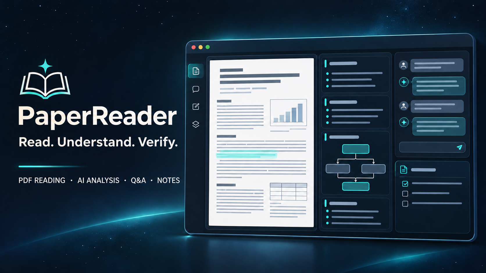
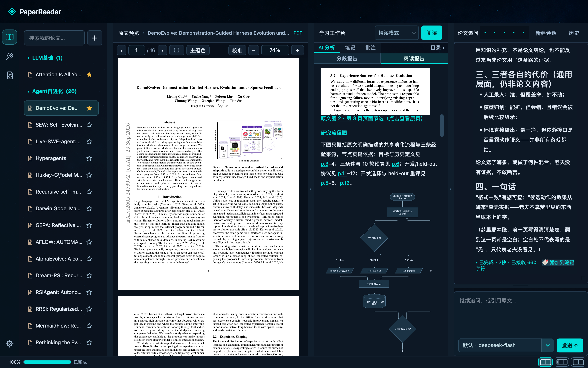
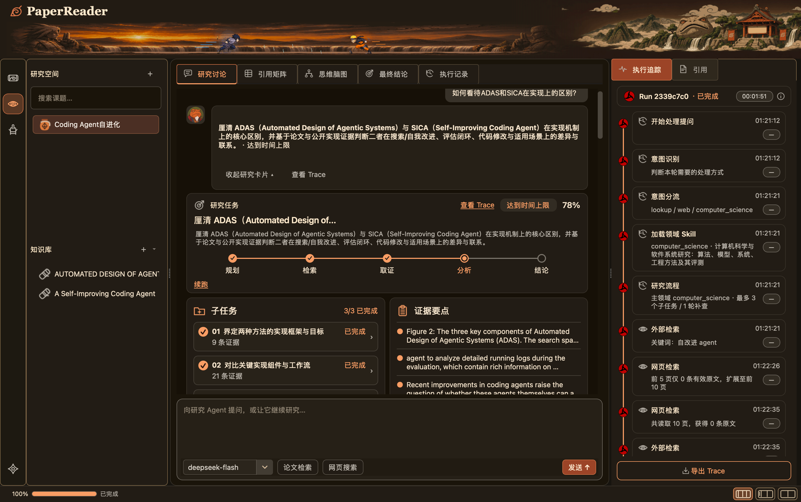

# PaperReader

<a href="README.md">简体中文</a> · <strong>English</strong>

PaperReader is an AI assisted research paper workspace for macOS and Windows. Read a PDF beside its AI analysis, ask follow-up questions, and keep your study notes in one window.

## Screenshots

| Reading workspace · starfield theme | Research workspace · warm theme |
| --- | --- |
|  |  |

Click either image to view it at full size.

## Highlights

### Library and PDF reading

Import multiple local PDFs, an arXiv abstract page, or a direct PDF link. Duplicate files are recognized automatically. New papers go into “Ungrouped”; you can then search, favorite, create groups, and drag papers between them.

Read with continuous scrolling, zoom, and a fit-to-pane control. Drag across text or double-click a word to copy, ask, translate, highlight, or annotate it. Your reading position and annotations are saved with the paper.

### Quick and deep AI reading

Quick reading extracts the research question, key results, and reading advice from important pages to help you decide what to read closely. Deep reading first produces a **segment report** organized by chapter or page range, then a **full report** that connects the method, evidence, results, and limitations.

Page references in reports can take you back to the PDF. Relevant figures and research flowcharts appear inline, and flowcharts can be opened in a full-screen preview. Results stream in as they are generated; you can keep partial work and resume an interrupted reading task.

### Follow-up questions and translation

Ask about a PDF selection or type a question in the right pane and continue the conversation. Answers draw on retrieved paper passages; valid page references jump to the source and briefly highlight the supporting evidence. Selected text can also be translated in a separate window without changing the PDF.

Each paper can have multiple independent conversations. Revisit earlier questions through History or add a useful exchange to your notes.

### Research workspace

Bring local papers and other sources together around a topic and continue work in one place. Separate views show the research discussion, task progress, evidence matrix, mind map, final conclusions, and execution trace. Open a citation to inspect the evidence behind a finding.

### Study records and workspace

Notes, annotations, analysis reports, conversations, and reading progress stay on your device and can be exported per paper. You can switch model configurations; API keys are stored in the OS keychain, while model requests go through the provider you configure.

The paper list, PDF, AI analysis, and chat can stay visible together. Four-, three-, and two-pane presets set the initial layout; you can still drag pane widths afterward. Choose a theme and decide whether the PDF background follows it.

## Get started

1. Download the macOS Apple Silicon or Windows x64 ZIP from the [latest release](https://github.com/qihanlin200/PaperReader/releases/latest). On macOS, unzip and open `PaperReader.app`. On Windows, unzip and run `PaperReader/PaperReader.exe`.
2. Import a PDF, or paste an arXiv abstract page or direct PDF link.
3. In **Settings → Model Settings**, enter an OpenAI Chat Completions compatible API URL, model name, and key.
4. Select **Quick/Deep → Read** to generate a report. Ask about selected PDF text or type a question in the right pane.
5. Keep your own understanding in **Notes**. Open the **Research workspace** when you want to investigate a topic across sources.

Check AI conclusions against the source paper.

## Run from source

Python 3.10 or newer is required:

| macOS | Windows |
| --- | --- |
| Run `./install.command`, then `./run.command` | Run `install.bat`, then `run.bat` |

More details: [dependency setup](docs/Python安装依赖.md) · [macOS build](docs/macOS打包说明.md) · [Windows build](docs/Windows打包说明.md)
