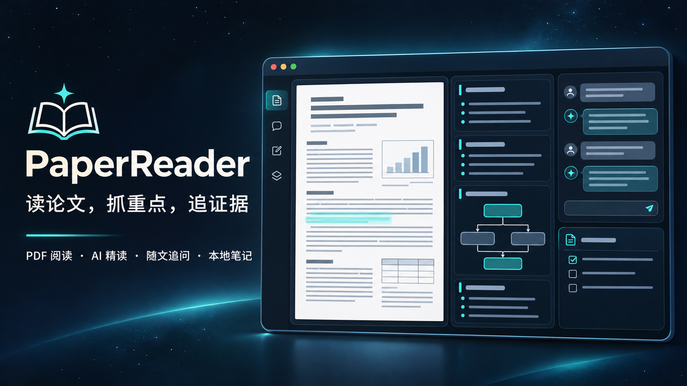
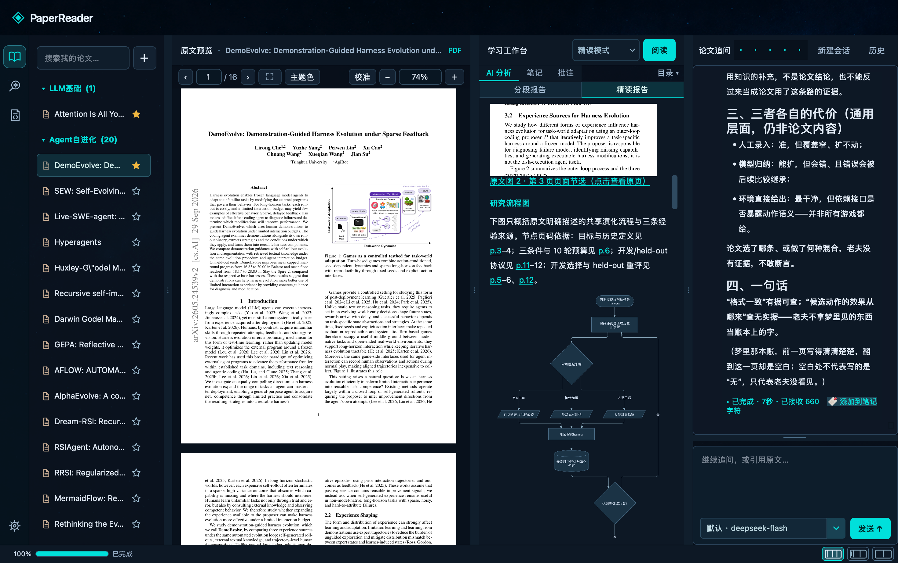
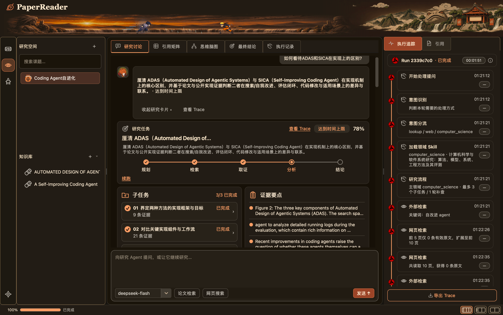

# PaperReader

<strong>简体中文</strong> · <a href="README.en.md">English</a>

PaperReader 是面向 macOS 和 Windows 的 AI 论文阅读工作台。在同一个窗口中对照 PDF 原文、阅读 AI 分析、继续追问，并整理自己的学习记录。

## 真实界面

| 阅读工作台 · 星空主题 | 研究空间 · 暖色主题 |
| --- | --- |
|  |  |

点击图片可查看完整尺寸。

## 主要功能

### 论文库与 PDF 原文

批量导入本地 PDF，或粘贴 arXiv 摘要页、PDF 直链；相同文件自动去重。新论文先进入“未分组”，之后可搜索、收藏、创建分组，并拖动论文调整归属。

原文支持连续滚动、缩放和按栏宽校准。拖选或双击选中文字后，可以复制、追问、翻译、高亮或添加批注；阅读位置与标注会随论文保存。

### AI 快读与精读

快读从论文的关键页面提取研究问题、主要结果与阅读建议，帮助判断是否需要细读。精读先形成按章节或页段组织的**分段报告**，再给出串联方法、证据、结果和局限的**精读报告**。

报告中的页码可跳回 PDF；相关原文图和研究流程图可直接查看，流程图支持双击放大。生成内容会逐步显示，任务中断后可保留已有结果并继续阅读。

### 随文追问与翻译

可以针对 PDF 选区发起问题，也可以在右侧直接提问并连续追问。回答会结合检索到的论文段落；点击有效页码可定位原文并临时高亮对应证据。选区翻译在独立窗口显示，不会改动 PDF。

每篇论文可建立多个独立会话，通过历史记录回看之前的问题和答案，也可把有用的问答加入笔记。

### 研究空间

围绕课题组织本地论文和其他来源，让研究任务在同一空间内持续推进。研究讨论、任务进度、引用矩阵、思维脑图、最终结论与执行记录分别展示；点击引用可回看证据，便于追溯结论的来源。

### 学习记录与工作台

笔记、批注、分析报告、问答会话和阅读进度保存在本机，并可按论文导出学习内容。模型配置可切换，API 密钥由系统密钥库保管；发给模型的请求仍会经过所配置的服务商。

论文列表、PDF、AI 分析和追问可同时显示；右下角的四折叠、三折叠、双折叠预设只调整初始分栏状态，切换后仍可拖动宽度。界面提供多种主题，PDF 背景也可选择是否跟随主题。

## 开始使用

1. 从 [最新版本](https://github.com/qihanlin200/PaperReader/releases/latest) 下载 macOS Apple Silicon 或 Windows x64 压缩包。macOS 解压后打开 `PaperReader.app`；Windows 解压后运行 `PaperReader/PaperReader.exe`。
2. 导入 PDF，或粘贴 arXiv 摘要页、PDF 直链。
3. 在**系统设置 → 模型设置**中填写兼容 OpenAI Chat Completions 的 API 地址、模型名和密钥。
4. 选择**快读/精读 → 阅读**生成报告；在 PDF 中选中文字追问，或在右侧输入问题。
5. 用**笔记**保留自己的理解；需要围绕多个来源继续研究时，打开**研究空间**。

AI 结论请结合原文核对。

## 从源码运行

需要 Python 3.10 或更新版本：

| macOS | Windows |
| --- | --- |
| `./install.command`，然后 `./run.command` | 运行 `install.bat`，然后运行 `run.bat` |

更多说明：[依赖安装](docs/Python安装依赖.md) · [macOS 打包](docs/macOS打包说明.md) · [Windows 打包](docs/Windows打包说明.md)
