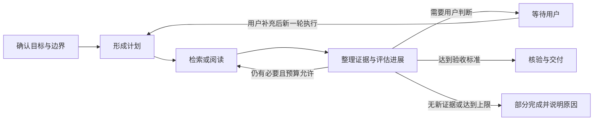
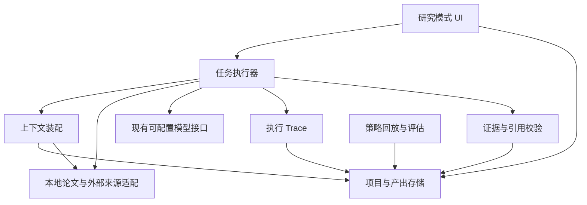

# PaperReader 研究模式与研究 Agent 设计说明书

- 版本：v0.1（设计讨论稿）
- 日期：2026-11-10
- 适用平台：macOS、Windows
- 目标：在现有阅读模式之外，增加以研究项目为中心、可核对依据、可追踪执行过程的研究模式

## 1. 定位与边界

PaperReader 保留现有**阅读模式**：围绕单篇论文阅读、标注、生成分析和追问。新增**研究模式**：围绕一个研究项目，综合多篇论文及可选的外部资料，帮助用户理解领域、解决具体问题、形成有依据的方案与结论。

研究模式面向个人学术研究和实际项目中的方案研究。它同时支持两种任务，但二者共用一个项目空间与证据库：

| 任务 | 起点 | 典型产出 |
| --- | --- | --- |
| 跨论文研究 | 一组论文、研究主题或开放问题 | 观点与创新点对照、方法演进、矛盾证据、研究空白、脑图、结论 |
| 项目问题求解 | 待实现的功能或待解决的问题，以及约束条件 | 业界与学术方案、选型比较、实施建议、验证实验、决策记录 |

用户可以先整理多篇论文，再提出项目问题；也可以先提出问题，再补充论文。研究 Agent 提供分析与建议，最终研究结论和项目决策由用户确认。它不把未经验证的推断写成论文事实，也不自动修改项目代码或替用户执行外部业务操作。

**项目空间不等于现有论文列表分组。**分组只整理资料库中的论文；项目空间还保存目标、约束、任务、证据、对话、产出和决策。同一篇论文可以加入多个项目，不复制 PDF 文件。

## 2. 主要使用流程

1. 在顶部切换到「研究模式」，新建研究项目，填写项目目标、背景、约束、期望产出；允许先只填项目名称，后续补全。
2. 从现有资料库选择多篇论文加入项目。论文仍可在阅读模式打开；点击研究结论的引用可跳转到原文页和片段。
3. 在项目中创建研究任务：选择「跨论文研究」或「项目问题求解」，输入问题及验收要求。Agent 先复述任务边界和可用资料，再给出可编辑的研究计划。
4. Agent 按计划检索、阅读、比较、核验并分段呈现结果。用户可在底部输入框持续提问、补充约束、要求重查证据或停止当前执行。
5. 用户审阅证据矩阵、结论、方案和图示；确认、纠正或驳回关键判断。确认后的内容成为项目决策记录，而不是无条件覆盖原始证据。
6. 任务结束后可查看执行 Trace、导出研究成果，并按需将结论或引用加入项目笔记。用户反馈可形成后续策略改进候选。

## 3. 功能设计

### 3.1 项目空间与任务

每个项目保存：名称、目标、背景、约束、论文集合、外部资料、项目笔记、研究任务、证据、结论、决策与导出成果。项目内允许多个独立任务，任务分别保存对话和执行记录；经用户确认的项目级结论可被其他任务引用。移出项目只解除关联，不删除资料库原论文及其阅读记录。

任务创建时建议记录：核心问题、用途、成功判据、时间/成本限制、可用资料范围、允许联网搜索与否、期望输出形式。信息缺失但不妨碍推进时，Agent 标明假设继续；会改变方向或结论的缺失信息，应向用户提问。

### 3.2 资料发现与证据整理

- **本地资料**：在项目论文及现有资料库中检索相关段落，保留论文 ID、PDF 页码、段落位置和原文摘录。跨论文去重、合并同一论文的不同版本信息。
- **外部资料**：在用户允许联网时，查询学术元数据、可合法获取的全文和与项目相关的行业资料。区分「已读全文」「仅有摘要」「仅有元数据」「网页资料」；不能把摘要或搜索结果写成全文证据。外部来源应保存地址、访问时间和版本信息。
- **证据条目**：记录主张、出处、原文位置、来源类型、支持/反驳关系、核验状态。可按研究问题、论文、方法、实验和年份筛选。
- **证据质量**：同一观点出现冲突时并列呈现，检查适用场景、实验条件和资料时效；无法核实的结论明确标为待验证。

对外部研究资源的接入可采用公开 API，例如 [OpenAlex](https://help.openalex.org/api/)；具体来源、访问额度和可用全文范围在实现阶段逐项确认。网页发现结果只能作为线索，引用时必须能回到具体来源。

### 3.3 Agent 研究能力

Agent 的任务链是：澄清目标 → 制定计划 → 检索与阅读 → 提取证据 → 比较与质疑 → 形成结论或方案 → 核验引用 → 交付。计划允许根据新证据调整，但每次变更都记录原因。

跨论文研究应能回答：各论文解决什么问题、核心创新是什么、方法有什么共同点与差异、实验支撑强弱如何、局限与争议在哪里、有哪些可进一步研究的方向。项目问题求解应能把论文思路与实际约束对应起来，给出多个可行方案的适用条件、代价、风险、优先级和最小验证实验。

交付物首选可编辑 Markdown：研究报告、方案比较表、证据矩阵、决策备忘录；脑图和流程图可先用结构化节点/边生成，并提供编辑与导出。所有关键结论都能回到证据；回答中显式区分**来源事实、跨来源综合、Agent 推断、用户确认的决定**。

### 3.4 人机协作与交互入口

研究模式使用独立界面。顶部保留「阅读 / 研究」切换；左侧为项目和项目资料；中间为任务讨论、计划及研究成果；右侧切换「证据 / 执行 Trace」；中间底部**始终可见的对话输入框**是与 Agent 交互的主要入口。用户也可从论文选区、证据条目、方案卡片发起上下文追问，问题会带上明确可见的引用。

任务运行时显示当前阶段、已检查的来源数量、等待的模型/工具步骤和停止按钮。输出采用流式展示，但阶段状态、正文与 Trace 彼此独立，避免滚动或切换项目时把内容写入其他任务。用户切换到阅读模式后，研究任务仍关联原项目；返回时能看到当前状态及已完成产出。

## 4. Agent Loop 与退出机制

一个项目可以长期存在，但**每次任务执行都必须有边界**。建议状态为：`待开始 → 规划中 → 执行中 → 等待用户 / 已完成 / 部分完成 / 失败 / 已停止`。

退出条件按优先级检查：

1. 用户点击停止，立即阻止后续模型与工具调用，保留已取得的证据、部分结果和检查点。
2. 目标及验收条件已满足，引用核验通过，生成可审阅的最终产出。
3. 关键方向、资料权限或结论取舍需要用户决定，进入「等待用户」。
4. 资料不足、来源冲突未解、连续检索无新增有效信息，按「部分完成」结束并列出缺口。
5. 达到预设步数、检索轮数、模型调用、时间或费用上限，结束当前轮次并保留续跑入口。
6. 工具不可恢复错误时标明失败阶段，允许从最近检查点重试。

每一步完成后写入检查点。继续执行从检查点创建新一轮有界运行；不能因为模型说“继续研究”就无限自循环。Agent 可提出下一步建议，但超出任务范围或预算的扩展需用户确认。此处采用交替执行与观察的思路，参考 [ReAct 论文](https://arxiv.org/abs/2210.03629)，具体循环边界是本产品的设计决定。

## 5. 记忆与上下文

**记忆**是存于本机、可查看和修正的长期资料；**上下文**是某次模型请求临时选取的内容。二者必须分开。

| 层级 | 内容 | 生命周期 |
| --- | --- | --- |
| 原始来源 | PDF、网页快照/链接、页码、原文定位 | 跟随资料与项目保留 |
| 项目记忆 | 目标、约束、已确认事实、决定、未解决问题 | 跟随项目保留 |
| 任务记忆 | 任务目标、计划、证据、对话摘要、阶段产出 | 跟随任务保留 |
| 运行状态 | 当前步骤、预算、检查点、工具结果、错误 | 跟随一次运行保留 |
| 用户偏好 | 用户明确设置的表达、研究深度等偏好 | 用户可编辑、可清除 |
| 策略记忆 | 已验证的检索与分析策略版本 | 独立版本管理、可回滚 |

每条研究记忆应有作用域、类型、出处、创建与更新时间、核验状态及版本。**项目间默认隔离**：一个项目的事实不能被自动当成另一个项目的背景。用户主动共享的论文仍以原文为依据；项目级结论跨项目引用时需明确来源。

每次模型调用按预算装配：任务目标与约束 → 当前计划/进度 → 相关项目记忆 → 检索到的原文证据 → 最近对话及较早对话摘要 → 输出空间。长论文和长历史不直接整体塞入请求；摘要用于导航，关键论断仍回查来源。现有阅读模式的「最大输入长度」按字符计，研究模式实现时应增加模型可配置的 token 预算估算及输出预留，不能把字符数当作 token 数。

## 6. 执行 Trace 与问题定位

用户需要能看见 Agent 做了什么、哪一步耗时或出错。Trace 记录**可观察的执行事件及简要决策依据**，不依赖展示模型隐藏的逐字内部推理。

以 `project_id → task_id → run_id → span_id` 关联事件。每个步骤记录开始/结束时间、父步骤、状态、输入摘要、结果摘要和可跳转的证据 ID。主要事件包括：任务规划与变更、检索词和命中数、论文/网页读取、证据提取、模型调用、工具重试、引用核验、输出生成、用户干预、停止与检查点。模型调用记录配置 ID、模型名、耗时、输入/输出用量（服务端可提供时）、错误与重试次数；策略版本也随运行固定。

界面右栏「执行 Trace」按时间线展示步骤，支持展开、筛选错误/慢步骤，并从回答跳到相关 Trace、从 Trace 跳到证据或 PDF 位置。Trace 默认只保存在本地，支持导出脱敏诊断包与按项目删除。API Key 绝不写入 Trace；完整提示词和响应正文默认不记录，必要的调试明文记录应由用户单独开启并能清除。Trace/span 的层级设计可参考 [OpenTelemetry 的概念](https://opentelemetry.io/docs/concepts/signals/traces/)，首版无需因此引入外部观测服务。

## 7. 自进化设计

首版自进化指**研究策略的受控改进**，不训练基础模型、不自动改写程序代码。它与单次研究任务 Loop 分离，避免 Agent 在执行任务时自行更换规则。

1. 收集反馈：用户纠正、接受/驳回的结论、实际验证结果、缺失证据、错引、任务耗时及费用。
2. 形成候选：一次只修改少量策略参数，例如检索词扩展、来源排序、证据核验顺序、报告模板或模型/工具路由。
3. 离线回放：在固定历史案例和保留案例上比较旧版与候选版，检查引用准确率、问题覆盖、结论适配度、用户修改量、耗时和费用。
4. 审阅与发布：展示改动及前后结果，由用户选择启用；策略有版本号，可回滚。项目专属策略不自动影响其他项目。

Agent 自评可作为诊断线索，不能单独证明能力提高；要结合可核对证据、真实用户反馈和任务结果。语言反馈驱动后续行为的方向可参考 [Reflexion 论文](https://proceedings.neurips.cc/paper_files/paper/2023/hash/1b44b878bb782e6954cd888628510e90-Abstract-Conference.html)。主题所绑定的角色名称与口吻由主题配置控制，自进化不得悄悄修改它们。

## 8. 技术结构与数据关系

研究模式应复用现有 PDF 库、模型配置、主题和阅读定位能力，但研究数据与运行逻辑独立组织，避免继续堆入 `window.py` 或单篇分析服务。建议按职责分为：研究界面、项目存储、跨论文索引与来源适配、Agent 执行器、上下文装配、证据与引用校验、Trace 记录、策略评估。以下是逻辑模块，非已实现文件清单。

核心实体建议包括：`Project`、`ProjectPaper`、`Source`、`ResearchTask`、`AgentRun`、`Evidence`、`Claim`、`Artifact`、`Decision`、`TraceSpan`、`StrategyVersion`、`Feedback`。这些实体用稳定 ID 关联；论文仍由原资料库管理。项目数据、Trace 和策略记录保存在本机；外部模型 API 只接收当前任务装配所需的文本，不承担资料云存储。API Key 继续使用系统密钥库，不进入项目数据库、导出文件或 Trace。

删除项目时应清楚区分「只删除项目及其研究记录」与「删除资料库原论文」；默认不删除原论文。导出报告时同时导出引用清单和来源信息，图示保留可编辑结构，不仅输出截图。

## 9. 分期交付建议

| 阶段 | 范围 | 完成判据 |
| --- | --- | --- |
| M1：项目与本地多论文研究 | 模式切换、项目、选多篇论文、任务对话、跨论文检索、证据引用、停止/续跑、基础 Trace、Markdown 报告 | 能对项目内论文提出问题，回答可逐条回到 PDF，切换项目不串内容 |
| M2：项目问题求解 | 约束录入、方案比较、实验建议、决策记录、可编辑脑图/流程图 | 能比较至少两种方案并说明证据、假设与待验证项 |
| M3：外部资料发现 | 学术元数据与网页来源适配、来源分级、去重和时效检查 | 能区分全文、摘要和网页资料，外部结论可回到原链接 |
| M4：受控自进化 | 反馈收集、策略候选、回放评估、版本切换与回滚 | 用户能看到改动依据与对照结果，并一键回退 |

基础 Trace 和证据定位应从 M1 同步建设；若等功能完成后再补，难以追查早期运行结果。脑图、流程图和外部资料发现可在数据模型中预留，按阶段补齐。

## 10. 验收与待确认事项

首版研究模式至少满足：

- 同一项目可关联多篇论文，同一论文可进入多个项目，原文件不重复复制。
- 每条主要结论标明来源事实、综合判断或推断；可定位的论文引用点击能打开对应 PDF 页和片段。
- 同时打开两个项目时，任务对话、运行状态、记忆和 Trace 不串项目。
- 用户停止后不再发起新步骤，部分结果与停止原因可恢复查看；达到预算上限时不会无限继续。
- 研究结果、项目笔记、决策和 Trace 重启应用后仍在本地；导出内容不含 API Key。
- 模型流式输出期间，阅读、滚动、项目切换和查看 Trace 保持可用。

实现前仍需确认：外部网页搜索是否进入首个可用版本、允许访问的来源范围、任务默认时间/调用预算、研究项目导出格式优先级、是否需要项目级资料快照。这些问题不影响 M1 的项目与本地多论文研究设计。
